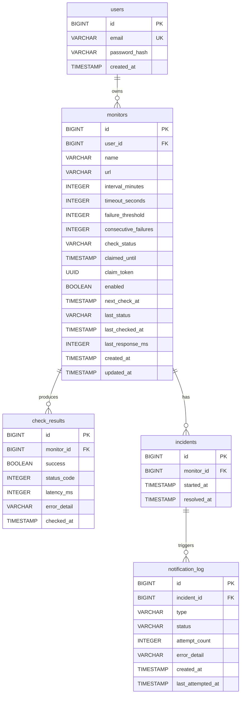

# PulseOps — Database Design

> Status: Decisions locked — awaiting backend skeleton | Updated: 2026-11-17

---

## 1. ER Diagram



---

## 2. Table Definitions

### `users`
| Column | Type | Constraints |
|---|---|---|
| `id` | `BIGINT` | PK, generated |
| `email` | `VARCHAR(255)` | NOT NULL, UNIQUE |
| `password_hash` | `VARCHAR(60)` | NOT NULL (bcrypt output) |
| `created_at` | `TIMESTAMPTZ` | NOT NULL, DEFAULT `now()` |

### `monitors`
| Column | Type | Constraints |
|---|---|---|
| `id` | `BIGINT` | PK, generated |
| `user_id` | `BIGINT` | NOT NULL, FK → users ON DELETE CASCADE |
| `name` | `VARCHAR(100)` | NOT NULL |
| `url` | `VARCHAR(2048)` | NOT NULL |
| `interval_minutes` | `INTEGER` | NOT NULL, DEFAULT 5, CHECK 1–60 |
| `timeout_seconds` | `INTEGER` | NOT NULL, DEFAULT 10, CHECK 1–30 |
| `failure_threshold` | `INTEGER` | NOT NULL, DEFAULT 3, CHECK 1–10 |
| `consecutive_failures` | `INTEGER` | NOT NULL, DEFAULT 0 |
| `check_status` | `VARCHAR(10)` | NOT NULL, DEFAULT `'IDLE'` (`IDLE`\|`RUNNING`) |
| `claimed_until` | `TIMESTAMPTZ` | NULL — lease expiry timestamp; NULL when IDLE |
| `claim_token` | `UUID` | NULL — random token set at claim time; NULL when IDLE |
| `enabled` | `BOOLEAN` | NOT NULL, DEFAULT TRUE |
| `next_check_at` | `TIMESTAMPTZ` | NOT NULL, DEFAULT `now()` |
| `last_status` | `VARCHAR(10)` | NULL (`UP`\|`DOWN`) — null until first check |
| `last_checked_at` | `TIMESTAMPTZ` | NULL |
| `last_response_ms` | `INTEGER` | NULL |
| `created_at` | `TIMESTAMPTZ` | NOT NULL, DEFAULT `now()` |
| `updated_at` | `TIMESTAMPTZ` | NOT NULL, DEFAULT `now()` — managed by Spring Data JPA `@LastModifiedDate` |

### `check_results`
| Column | Type | Constraints |
|---|---|---|
| `id` | `BIGINT` | PK, generated |
| `monitor_id` | `BIGINT` | NOT NULL, FK → monitors **ON DELETE CASCADE** |
| `success` | `BOOLEAN` | NOT NULL |
| `status_code` | `INTEGER` | NULL (null = network/timeout error) |
| `latency_ms` | `INTEGER` | NULL |
| `error_detail` | `VARCHAR(500)` | NULL |
| `checked_at` | `TIMESTAMPTZ` | NOT NULL, DEFAULT `now()` |

### `incidents`
| Column | Type | Constraints |
|---|---|---|
| `id` | `BIGINT` | PK, generated |
| `monitor_id` | `BIGINT` | NOT NULL, FK → monitors **ON DELETE CASCADE** |
| `started_at` | `TIMESTAMPTZ` | NOT NULL, DEFAULT `now()` |
| `resolved_at` | `TIMESTAMPTZ` | NULL (null = still open) |

### `notification_log`
| Column | Type | Constraints |
|---|---|---|
| `id` | `BIGINT` | PK, generated |
| `incident_id` | `BIGINT` | NOT NULL, FK → incidents **ON DELETE CASCADE** |
| `type` | `VARCHAR(10)` | NOT NULL (`OPEN`\|`RECOVERY`) |
| `status` | `VARCHAR(10)` | NOT NULL (`PENDING`\|`SENT`\|`FAILED`) |
| `attempt_count` | `INTEGER` | NOT NULL, DEFAULT 0 |
| `error_detail` | `VARCHAR(500)` | NULL |
| `created_at` | `TIMESTAMPTZ` | NOT NULL, DEFAULT `now()` |
| `last_attempted_at` | `TIMESTAMPTZ` | NULL |

---

## 3. ID Choice: BIGINT over UUID

**BIGINT** (auto-increment / sequence). Smaller index footprint, faster joins, simpler JPA mapping. UUIDs only matter for distributed ID generation across nodes — not in scope here.

---

## 4. Indexes

| Index | Table | Columns / Filter | Why |
|---|---|---|---|
| `idx_cr_monitor_checked` | `check_results` | `(monitor_id, checked_at DESC)` | History pagination and per-monitor uptime aggregation |
| `idx_cr_checked_at` | `check_results` | `(checked_at)` | Daily purge: `DELETE WHERE checked_at < now() - 30d` without full scan |
| `idx_mon_next_check` | `monitors` | `(next_check_at) WHERE enabled = TRUE AND check_status = 'IDLE'` | Scheduler tick — partial index omits paused and running rows |
| `idx_mon_user_id` | `monitors` | `(user_id)` | List monitors by owner; anchors uptime batch query |
| `idx_inc_monitor_id` | `incidents` | `(monitor_id)` | Incident history per monitor |
| `uix_inc_one_open` | `incidents` | `(monitor_id) WHERE resolved_at IS NULL` | Partial unique index — at most one open incident per monitor |

> **Filtered index (interview):** Only rows matching the predicate are stored in the index. `idx_mon_next_check` is physically small because it excludes paused and running monitors. PostgreSQL uses it only when the query WHERE clause matches the predicate exactly.

---

## 5. Reliability Enforcement

### Worker crash recovery — `claimed_until` lease and `claim_token`

**Single wall-clock deadline.** Each check has one overall deadline (default 30 s, equal to `timeout_seconds`) covering DNS resolution, TCP connect, TLS handshake, all redirect hops, and response body read. There is no separate per-hop timeout. The HTTP client is configured with this single deadline applied to the entire operation.

**Lease relationship to deadline.** `claimed_until` must be strictly larger than the wall-clock deadline to avoid a live check being stolen mid-flight:

```
claimed_until = now() + timeout_seconds + margin
             = now() + 30s + 60s
             = now() + 90s   (default)
```

The margin (60 s) covers scheduler tick jitter, thread-pool queuing delay, and DNS pre-resolution time. If `timeout_seconds` is lowered, the lease shrinks proportionally; the margin stays fixed.

**`claim_token` — ownership proof.** A random UUID generated in Step 1 and stored on the monitor row. Step 3's UPDATE is conditional on this token, so a save from a stale claim cannot overwrite a newer one:

```sql
-- Step 1 — CLAIM TX (short, milliseconds):
UPDATE monitors
SET check_status  = 'RUNNING',
    claimed_until = now() + (timeout_seconds * INTERVAL '1 second') + INTERVAL '60 seconds',
    claim_token   = :newToken        -- random UUID generated by the worker thread
WHERE id = :monitorId
  AND enabled = TRUE
  AND next_check_at <= now()
  AND (check_status = 'IDLE'
       OR (check_status = 'RUNNING' AND claimed_until < now()))
RETURNING id;
-- 0 rows → already claimed or deleted; skip this monitor
```

```sql
-- Step 3 — SAVE TX: conditional on token
UPDATE monitors
SET consecutive_failures = ...,
    last_status          = ...,
    last_checked_at      = now(),
    last_response_ms     = :latencyMs,
    check_status         = 'IDLE',
    next_check_at        = now() + (interval_minutes * INTERVAL '1 minute'),
    claimed_until        = NULL,
    claim_token          = NULL,
    updated_at           = now()
WHERE id = :monitorId
  AND claim_token = :myToken;   -- only succeeds if we still own the claim
-- 0 rows → claim was stolen (lease expired and re-claimed) OR monitor deleted;
--           discard result without error, log at DEBUG
```

> **Interview point — why `claim_token`?** `claimed_until` alone prevents a *new* claim during a live check, but it cannot prevent a stale result from landing after a lease has expired and been re-claimed. Without the token, a delayed save-tx could overwrite a fresher result. With the token, the conditional `WHERE claim_token = :myToken` guarantees the write is a no-op if ownership changed, regardless of timing.

### Three-step check execution — HTTP call outside any transaction

```
Step 1 — CLAIM TX (short, ~ms)
  BEGIN
    UPDATE monitors SET check_status='RUNNING', claimed_until=now()+90s,
                        claim_token=:newToken WHERE ... RETURNING id
    0 rows → skip (already claimed, lease not expired, or deleted)
  COMMIT — connection returned to pool immediately

Step 2 — HTTP CHECK (outside any transaction, up to 30 s wall-clock)
  Single deadline covers: DNS resolve → TCP connect → TLS → redirects → body read
  SSRF-validated IP passed directly to HTTP client (no re-resolve)

Step 3 — SAVE TX (short, ~ms)
  BEGIN
    INSERT INTO check_results (...)
    UPDATE monitors SET consecutive_failures=..., check_status='IDLE',
           next_check_at=..., claim_token=NULL, claimed_until=NULL, ...
           WHERE id=:id AND claim_token=:myToken
    0 rows updated → claim lost or monitor deleted; log DEBUG, commit, return
    INSERT INTO incidents (...) if threshold crossed  [catch DataIntegrityViolationException]
    UPDATE incidents SET resolved_at=now() if recovered
  COMMIT
```

**Why HTTP must be outside a transaction:** a DB connection is held open for the life of a transaction. HTTP calls can take up to 30 s (the configured timeout). Holding a connection for 30 s under any load exhausts the connection pool fast. No transaction means the connection is returned to the pool immediately after Step 1 and re-acquired for Step 3.

### Race protection — RUNNING state + atomic UPDATE, not a held lock

The scheduler does **not** hold a database lock across the HTTP check. The protection against two threads running the same monitor simultaneously is:

1. **Claim UPDATE is conditional**: `WHERE check_status = 'IDLE' OR (check_status = 'RUNNING' AND claimed_until < now())`. Two threads racing on the same row produce one winner (1 row updated) and one loser (0 rows updated). The loser skips that monitor.
2. **`consecutive_failures` is incremented in SQL** (`+1`), not read-modify-written in Java. The save-tx UPDATE is atomic at the row level — no read required.
3. **Partial unique index on open incidents** is the backstop if two threads somehow both proceed.

> `FOR UPDATE SKIP LOCKED` can be added to the initial SELECT (not the UPDATE) for future multi-node workers — it lets threads skip rows being claimed by siblings without blocking. It is **not** needed for correctness in a single-node thread pool because the conditional UPDATE already serialises claims.

### No duplicate open incidents

```sql
CREATE UNIQUE INDEX uix_inc_one_open
  ON incidents (monitor_id)
  WHERE resolved_at IS NULL;
```

Service inserts an incident only when `consecutive_failures >= failure_threshold`. The index is a backstop. On `DataIntegrityViolationException`, the service logs a warning and continues — the existing open incident is preserved.

---

## 6. Uptime Query — no N+1

One grouped query across all monitors for the authenticated user:

```sql
SELECT monitor_id,
  COUNT(*) FILTER (WHERE success AND checked_at >= now() - INTERVAL '24 hours') AS ok_24h,
  COUNT(*) FILTER (WHERE checked_at >= now() - INTERVAL '24 hours')             AS total_24h,
  COUNT(*) FILTER (WHERE success AND checked_at >= now() - INTERVAL '7 days')   AS ok_7d,
  COUNT(*) FILTER (WHERE checked_at >= now() - INTERVAL '7 days')               AS total_7d,
  COUNT(*) FILTER (WHERE success AND checked_at >= now() - INTERVAL '30 days')  AS ok_30d,
  COUNT(*) FILTER (WHERE checked_at >= now() - INTERVAL '30 days')              AS total_30d
FROM check_results
WHERE monitor_id = ANY(:monitorIds)
GROUP BY monitor_id;
```

`idx_cr_monitor_checked` on `(monitor_id, checked_at DESC)` covers all three windows in one pass. The service merges the result map into the monitor list — no per-monitor queries.

---

## 7. Retention & Hard Delete

**Purge:** `DELETE FROM check_results WHERE checked_at < now() - INTERVAL '30 days'` — uses `idx_cr_checked_at`, runs daily at 03:00 UTC. Incidents and notification_log are kept permanently as audit records.

**Monitor hard delete:** `ON DELETE CASCADE` on `check_results.monitor_id`, `incidents.monitor_id`, and `notification_log.incident_id`. Deleting a monitor removes all its history atomically. The worker handles deletion mid-check by detecting 0 rows updated in the save transaction and exiting quietly.

---

## 8. Flyway Migrations (names only)

```
V1__create_users.sql
V2__create_monitors.sql
V3__create_check_results.sql
V4__create_incidents.sql
V5__create_notification_log.sql
V6__create_indexes.sql
```
